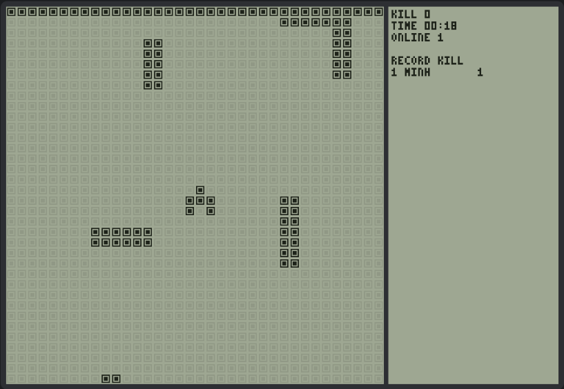

# Brick Tank

A massively multiplayer tank shooter for the browser, drawn like the LCD of the old "9999 in 1"
Brick Game handhelds. Everyone plays in one shared, never-ending world: one hit and you're out,
and you start again from zero.



## How it plays

- Your tank is 3×3 pixels. Arrow keys or WASD to move, Space to fire; on phones, on-screen
  buttons (move and fire at the same time with two fingers).
- Any bullet kills any tank — yours included. Each tank has one bullet in flight at a time, and it
  fades after 25 cells.
- New tanks blink for 3 seconds: they can't be hit and can't shoot.
- The map is fixed, but the playable area grows with the number of players and shrinks when they
  leave, so there are always about 2–3 other tanks on your screen.
- Two leaderboards — kills and time alive — for players alive right now, plus all-time records.
- Idle for 60 seconds and you're removed.

## Run it

You only need Docker.

```bash
docker compose up --build server
```

Open <http://localhost:8080>. Open a second window to see another tank.

## Develop

Rust runs inside Docker; the client is plain JavaScript with no build step.

```bash
docker compose run --rm dev cargo test --workspace                        # server tests
npm test                                                                  # client tests (Node 22)
docker compose run --rm --service-ports dev cargo run -p server --release # dev server on :8080
```

Edits under `client/` are served directly; reload the page to see them.

```
server/    Rust server: simulation, protocol, game loop, WebSocket front end
client/    browser client: index.html, style.css, js/
shared/    movement test cases run by both the Rust and the JS tests
loadtest/  bot swarm for capacity testing
deploy/    production notes and Caddy config
docs/      architecture, wire protocol, decision records
```

## Documentation

- [Architecture](docs/architecture.md) — how the server and client work.
- [Wire protocol](docs/protocol.md) — message formats, for writing your own client or bot.
- [Decision records](docs/decisions/README.md) — why things are the way they are.
- [Deployment](deploy/README.md) — running on a VPS, configuration, measured capacity.

## License

[MIT](LICENSE)
